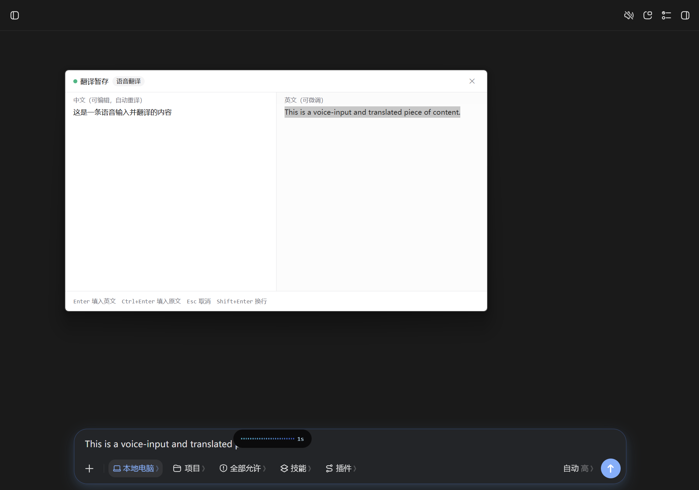
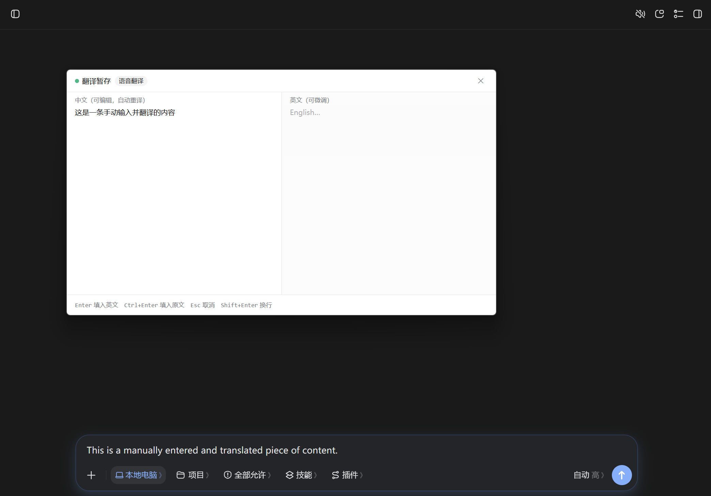
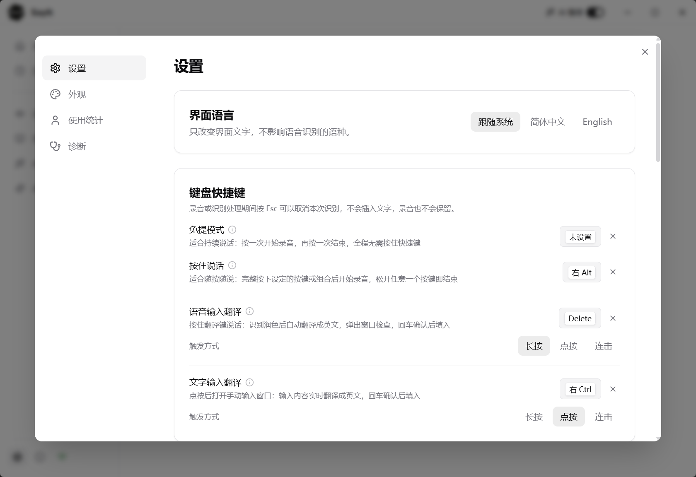
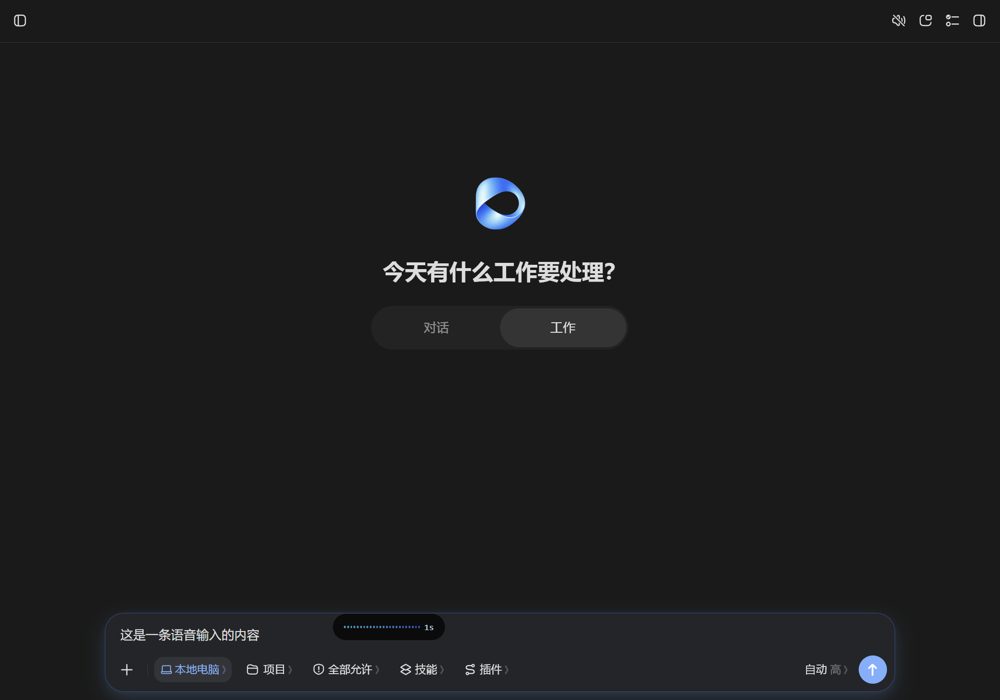

<div align="center">


# SayIt Translate

**Think in Chinese. Write in English.**

Global voice typing and live AI translation for Windows.

[](LICENSE)
[](https://github.com/niwoxijifiy91-bot/SayIt-Translate/releases/latest)
[](https://github.com/niwoxijifiy91-bot/SayIt-Translate/releases/latest)

**[Download for Windows](https://github.com/niwoxijifiy91-bot/SayIt-Translate/releases/latest)** · **[中文说明](README.md)** · **[Full change list](MODIFICATIONS.md)**

</div>

SayIt Translate is designed for people who think in Chinese but communicate in English. Hold a shortcut and speak; the app transcribes and polishes your words, translates them, then opens a staging window so you can review both versions before inserting the result into the app you were using.



## Features added by this fork

### Voice-to-English translation

Hold `Delete` and speak. When you release the key, SayIt runs speech recognition and AI cleanup, translates the result into English, and opens the staging window.

- Edit the Chinese source and the English translation refreshes automatically.
- Fine-tune the English result directly when needed.
- English-only or numeric input skips the translation call.

### Live manual translation

Press `Alt+Y` to open an empty staging window. Type in Chinese and the English side updates as you write.



### Review before insertion

| Shortcut | Action |
| --- | --- |
| `Enter` | Insert the English translation |
| `Ctrl+Enter` | Insert the Chinese source |
| `Shift+Enter` | Add a new line |
| `Esc` | Close without inserting anything |

### Configurable shortcuts and triggers

Voice typing, voice translation, and manual translation keys are configurable. Translation actions support hold, tap, and multi-press triggers.



> The screenshot shows one custom setup. Check the settings page for the bindings active on your installation.

## Original SayIt capabilities

This fork keeps SayIt's global voice typing, AI cleanup, cloud speech recognition, recording overlay, local history, and Chinese/English interface. Regular voice typing can still insert the polished source text directly into any editable app.



For the original project's full feature set, backend deployment, and documentation, visit [crosswk/SayIt](https://github.com/crosswk/SayIt).

## Default shortcuts

| Feature | Default key | Trigger |
| --- | --- | --- |
| Hold to type the source text | Left `Alt` | Hold |
| Hands-free voice typing | Right `Alt` | Tap to start and tap again to stop |
| Voice input and translation | `Delete` | Hold |
| Manual input and translation | `Alt+Y` | Tap |

All bindings can be changed under Settings → Keyboard shortcuts. A short `Delete` press continues to delete text normally.

## Install and configure

1. Download the Windows x64 installer from [Releases](https://github.com/niwoxijifiy91-bot/SayIt-Translate/releases/latest).
2. Configure a cloud ASR provider or connect to an available SayIt server.
3. Configure an AI provider, API address, API key, and model. AI cleanup and translation share this configuration.
4. Use a voice or translation shortcut in any text field.

This fork removes client-side local ASR. Voice recognition requires cloud ASR or a SayIt server, and translation requires a working AI provider.

## Development

The desktop client uses Tauri v2, React, TypeScript, and Rust.

```bash
cd client
npm install
npm run tauri dev
```

Requirements: Node.js 18+, Rust 1.75+, and Visual Studio Build Tools with MSVC. CMake and the Vulkan SDK are not required by this fork.

## Credits and license

SayIt Translate is a derivative of [crosswk/SayIt](https://github.com/crosswk/SayIt). Thanks to **crosswk** for building and open-sourcing the original voice-typing foundation.

This fork remains open source under the [GNU Affero General Public License v3.0](LICENSE).
