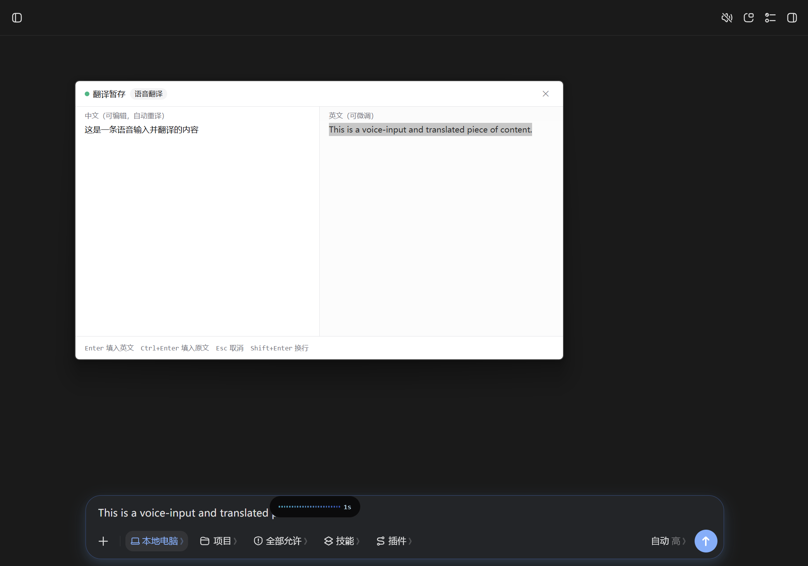
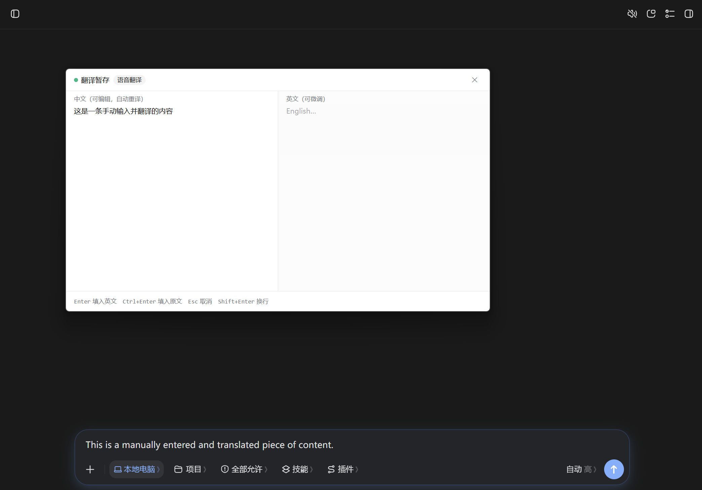
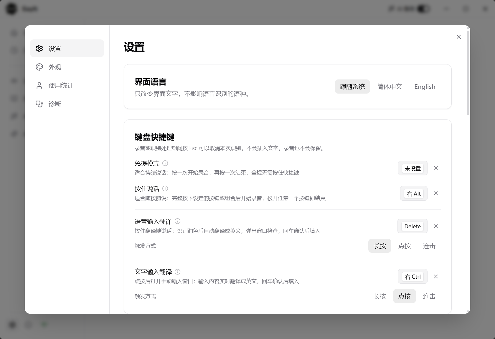
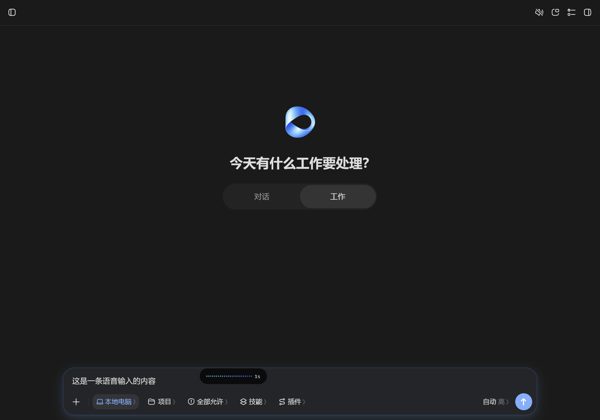

<div align="center">


# SayIt Translate

**说中文，直接得到英文。**

一款面向 Windows 的全局语音输入与 AI 实时翻译工具。

[](LICENSE)
[](https://github.com/niwoxijifiy91-bot/SayIt-Translate/releases/latest)
[](https://github.com/niwoxijifiy91-bot/SayIt-Translate/releases/latest)

**[下载 Windows 安装包](https://github.com/niwoxijifiy91-bot/SayIt-Translate/releases/latest)** · **[查看完整改动](MODIFICATIONS.md)** · **[English](README.en.md)**

</div>

SayIt Translate 适合需要频繁进行中英文沟通的人：跨境与外贸从业者、出海开发者、留学生，以及希望用中文思考、直接输出英文的用户。

按住快捷键说中文，松开后会出现翻译暂存窗口。你可以核对和修改中文，英文会自动更新；确认无误后按回车，译文会直接填入刚才正在使用的输入框。



## 这次二开增加了什么

### 1. 语音输入翻译

默认按住 `Delete` 说话：

`语音 → 识别 → AI 润色 → 英文翻译 → 暂存确认 → 填入当前输入框`

- 中文原文与英文译文同时显示，发送前可以检查。
- 修改中文后，英文会在约 600 ms 防抖后自动重新翻译。
- 英文译文也可以手动微调。
- 纯英文或数字内容不会重复调用翻译。

### 2. 手动输入实时翻译

默认按 `Alt+Y` 打开暂存窗口。不方便说话时，直接输入中文即可实时得到英文，确认后再填入当前应用。



### 3. 译文确认后再上屏

翻译不会未经确认就直接发出。暂存窗口提供以下操作：

| 操作 | 结果 |
| --- | --- |
| `Enter` | 填入英文译文 |
| `Ctrl+Enter` | 填入中文原文 |
| `Shift+Enter` | 换行 |
| `Esc` | 取消，不填入任何内容 |

### 4. 快捷键与触发方式都能修改

语音输入、语音翻译和手动翻译均支持自定义按键。翻译功能还可以选择长按、点按或连击触发，修改后立即生效。



> 截图展示的是一组自定义配置；首次安装时请以应用设置页显示的实际键位为准。

## 原版能力简述

本项目保留了 SayIt 的全局语音输入、AI 文本润色、云端语音识别、悬浮窗反馈、历史记录和中英文界面等基础能力。普通语音输入仍可将润色后的原文直接填入任意可输入文字的应用。



原版 SayIt 的完整功能、服务端部署和详细文档，请查看原作者仓库：[crosswk/SayIt](https://github.com/crosswk/SayIt)。

## 默认快捷键

| 功能 | 默认按键 | 默认触发方式 |
| --- | --- | --- |
| 按住说话，填入原文 | 左 `Alt` | 长按 |
| 免提语音输入 | 右 `Alt` | 点按开始，再按一次结束 |
| 语音输入并翻译 | `Delete` | 长按 |
| 手动输入并翻译 | `Alt+Y` | 点按 |

所有按键都可以在“设置 → 键盘快捷键”中修改。`Delete` 使用长按判定，短按仍可正常删除文字。

## 安装与使用

1. 从 [Releases](https://github.com/niwoxijifiy91-bot/SayIt-Translate/releases/latest) 下载 Windows x64 安装包。
2. 在“语音引擎”中配置云端 ASR，或使用可用的 SayIt 服务器。
3. 在“AI 供应商”中配置模型、API 地址和 API Key；润色与翻译共用这套配置。
4. 在任意输入框中使用语音输入或翻译快捷键。

> 此二开版本已移除客户端本地 ASR，语音识别需要云端 ASR 或 SayIt 服务器；翻译需要可用的 AI 供应商。

## 开发

客户端基于 Tauri v2、React、TypeScript 与 Rust。

```bash
cd client
npm install
npm run tauri dev
```

构建环境需要 Node.js 18+、Rust 1.75+ 和包含 MSVC 的 Visual Studio Build Tools。由于本版本已移除本地 ASR，因此不需要 CMake 或 Vulkan SDK。

测试与构建：

```bash
cd client
npm test
npm run build
cargo test --manifest-path src-tauri/Cargo.toml
```

## 开源说明与致谢

本项目基于 **crosswk** 开发的开源项目 [SayIt](https://github.com/crosswk/SayIt) 进行二次开发，感谢原作者提供完整的语音输入基础能力。

二开版本继续采用 [GNU Affero General Public License v3.0](LICENSE) 开源。你可以使用、修改和分发本项目；分发修改版本或以网络服务方式提供时，应按 AGPL-3.0 提供对应源代码。
